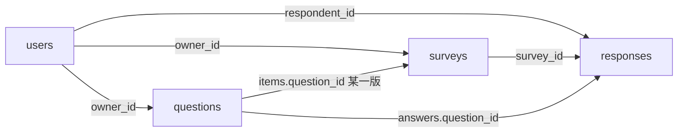

# 项目文档（系统 / 数据库 / API / 关键逻辑）

## 1. 系统说明

本系统是一个简化版在线问卷：注册用户建题、组卷、发布链接，其他人登录后填写，所有者看统计。

技术栈：Python · FastAPI · Jinja2 模板页 · Session Cookie · pymongo · 本地 MongoDB。

主要页面：

- `/register` `/login`：注册登录
- `/questions`：题库（新建、改题另存新版本、分享、跨卷统计）
- `/surveys`：我的问卷（选题、跳转、发布、关闭、本卷统计）
- `/survey/{slug}`：填写入口（必须登录）

JSON API 前缀 `/api`，给自动测试和文档用，和页面走同一套 `SurveyService`。

身份：填写必须先注册登录。问卷若勾选「允许匿名」，答卷仍有 `respondent_id`，只多一个 `anonymous` 标记。用户只能管理自己的问卷；被分享的题目可以引用进自己的卷，但不能改原题。

---

## 2. 数据库设计

四个集合：`users`、`questions`、`surveys`、`responses`。字段规则（类型、必填、取值）见 `survey-app/mongo-schema.md`，那里不是某一份问卷的范例。



### 为什么这样拆

- 用户、题目、问卷、答卷生命周期不一样。
- 题目要复用、分享、改版本，所以独立成 `questions`，问卷里只放引用。
- 版本用「一版一文档」：`_id` 是这一版，`logical_id` 串同一题家族，`version` 递增，`derived_from` 指向改自哪一版。保存 = insert 新文档，旧 `_id` 不变。
- 问卷 `items` 只存 `question_id`（某一版），不做 snapshot。旧卷继续指旧版，新卷可以指新版。
- 答卷 `answers` 同时带 `item_id` 和 `question_id`：本卷统计用前者，跨卷统计用后者。

---

## 3. API 说明

未登录访问需登录的接口返回 400/401。成功一般是 `{ "ok": true, ... }`，失败 `{ "ok": false, "error": "..." }`。

### 认证

| 方法 | 路径 | 输入 | 说明 |
|---|---|---|---|
| POST | `/api/auth/register` | `{username, password}` | 注册 |
| POST | `/api/auth/login` | 同上 | 写 session cookie |
| POST | `/api/auth/logout` | 无 | 清 session |
| GET | `/api/auth/me` | cookie | 当前用户 |

### 题库

| 方法 | 路径 | 说明 |
|---|---|---|
| GET | `/api/questions?scope=own\|bank\|shared` | 列表，可加 `category` |
| POST | `/api/questions` | 创建 v1 |
| GET | `/api/questions/{id}` | 某一版 |
| POST | `/api/questions/{id}/versions` | 基于该版另存为新版本 |
| GET | `/api/questions/logical/{logical_id}/versions` | 历史 |
| POST | `/api/questions/{id}/share` | `{username}` 分享 |
| GET | `/api/questions/{id}/usage` | 被哪些问卷引用 |
| GET | `/api/questions/{id}/stats` | 跨卷统计（所有者） |

创建题目 body 示例：

```json
{
  "type": "multi",
  "stem": "喜欢的水果",
  "options": ["苹果", "香蕉", "西瓜"],
  "category": "生活",
  "in_bank": true,
  "validation": { "min_select": 1, "max_select": 2 }
}
```

### 问卷

| 方法 | 路径 | 说明 |
|---|---|---|
| GET | `/api/surveys` | 我创建的 |
| POST | `/api/surveys` | 创建草稿 |
| GET | `/api/surveys/{id}` | 详情 |
| POST | `/api/surveys/{id}/items` | 设置题目列表（仅 draft） |
| PUT | `/api/surveys/{id}/jump_rules` | 整表替换跳转（仅 draft） |
| POST | `/api/surveys/{id}/publish` | 发布，链接 `/survey/{slug}` |
| POST | `/api/surveys/{id}/close` | 关闭 |
| GET | `/api/surveys/{id}/stats` | 本卷统计 |
| GET | `/api/surveys/{id}/stats/items/{item_id}` | 本卷单题 |

items 示例：

```json
{
  "items": [
    { "item_id": "q1", "question_id": "<某版id>", "required": true }
  ]
}
```

### 填写

| 方法 | 路径 | 说明 |
|---|---|---|
| GET | `/api/fill/{slug}` | 问卷结构（须登录、须已发布） |
| POST | `/api/fill/{slug}/next` | 当前题作答 → 下一题 |
| POST | `/api/fill/{slug}/submit` | 提交整卷，服务端按跳转路径校验 |

提交示例：

```json
{
  "anonymous": false,
  "answers": [
    { "item_id": "q1", "value": "男" },
    { "item_id": "q3", "value": ["苹果"] }
  ]
}
```

### 统计形状

- 单选：`{ type, options: [{label, count}], total_answers }`
- 多选：`{ type, options: [{label, count}], total_responses }`
- 文本：`{ type, values: [...] }`
- 数字：`{ type, values: [...], avg }`

页面路由与上表对应，见 `app/main.py`（表单 POST 和 JSON 双轨）。

---

## 4. 关键逻辑说明

实现集中在 `app/logic.py` 和 `app/services.py`。

### 跳转

规则在 `surveys.jump_rules`：`from_item` + `when` + `to_item`（可以是另一题或 `"end"`）。

`when.op`：

- `eq`：单选等于某选项
- `includes`：多选包含某选项
- `eq_number` / `between`：数字填空

没有命中规则时，按 `items` 顺序下一题。提交时从第一题沿规则走出一条路径，只保存路径上的答案；跳过的题不要求作答。

### 校验

`validate_answer(question, value, required)`：

- 必答空值报错
- 单选必须是 options 里的一项
- 多选检查项是否合法，以及 min/max/exact
- 文本检查长度
- 数字检查整数、最小/最大

规则来自题目文档的 `validation`，不是写死在某张卷里。
