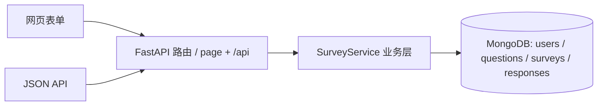

# 项目完成报告（大作业一 · 第二阶段）

学号：10245501470　姓名：唐竟涵　GitHub：<https://github.com/TinjiYDon/ecnu-pj1-survey>
本阶段代码在本目录 `survey-app/`。

***

## 1. 项目目标

做一套基于 MongoDB 的在线问卷系统：注册用户建题、组卷、配跳转、发布链接，其他人登录后填写，
所有者查看本卷统计；题目可存题库复用、可分享、可改版，且改题不能影响已发布的旧问卷。

第二阶段的目标是在一阶段的前提下，按《需求变更说明》补齐上述能力，重点是：

1. 改坏的题能恢复旧版本
2. 改题前能看清「这题被哪些问卷用、用的是哪一版」
3. 题库可管理（加入/移出），选题时按「题」而不是按「版本」展示
4. 同一题跨所有问卷、跨所有版本的统计能算出来
5. 保证阶段一已交付的功能与数据全部继续可用

***

## 2. 系统设计

分层：Jinja2 页面（表单） + JSON API（自动测试/文档） → `SurveyService` 业务层 → MongoDB 四个集合。



身份与会话：注册登录后写签名 Cookie（SessionMiddleware），密码用标准库 PBKDF2 哈希存储，不存明文。

权限：填写问卷必须登录；用户只能管理自己创建的问卷；被分享的题可引用进自己的卷，不能改原题。

生命周期：问卷发布后题目列表与跳转规则锁定；关闭或过截止时间不可填；未勾选「允许重复填写」时同一人只能交一份。

与阶段一相比，系统骨架完全不变，只扩展读查询口径和题库操作（详见第 6 节）。

***

## 3. 阶段一的设计是什么

四个集合：`users`、`questions`、`surveys`、`responses`。题目不嵌进问卷，「一版一文档」：

- `logical_id` 串同一题的版本家族，`version` 递增，`derived_from` 指向改自哪一版
- 问卷 `items.question_id` 钉死某一版；答卷 `answers.question_id` 支撑跨卷统计
- 改题 = insert 新版本，旧版内容不可变

阶段一提交时已提前做了需求变更的主体（题库独立、版本化、分享、按版本的跨卷统计），
但对照变更说明仍有四处未满足，且存在一个并发隐患（见第 4 节）。

***

## 4. 需求变更带来了哪些问题

| 变更需求       | 阶段一现状                            | 问题                                       |
| ---------- | -------------------------------- | ---------------------------------------- |
| 四、恢复旧版本    | 只有历史查看和 `derived_from`           | 没有恢复操作，改坏了找不回                            |
| 六、题被哪些问卷使用 | usage 只按单一版本 `_id` 查             | 改 v2 前看不到哪些卷还钉在 v1，正好违背该需求「改完怕影响别人问卷」的意图 |
| 七、题目库      | 只有 `in_bank` 布尔 + `category` 字符串 | 题库列表/组卷下拉把同一题 v1/v2/v3 全部列出；没有加入/移出操作    |
| 八、单题跨问卷统计  | 只统计一个版本                          | 同一题不同版本被不同卷引用时算不出「总体分布」                  |

***

## 5. 修改了哪些部分

| 文件                  | 修改                                                                                                                                                                                             |
| ------------------- | ---------------------------------------------------------------------------------------------------------------------------------------------------------------------------------------------- |
| `app/services.py`   | 新增 `restore_version`（恢复旧版）、`set_bank`（整族加入/移出题库）；`question_usage` / `cross_question_stats` 增加 `scope=version\|family`；`list_questions` 的 `bank` 范围按族只返回最新版；新增 `_insert_version`（撞唯一索引时重取版本号重试） |
| `app/db.py`         | `(logical_id, version)` 升级为唯一索引；启动时检测并替换旧的非唯一同名索引                                                                                                                                              |
| `app/main.py`       | 新增网页 `POST /questions/{qid}/restore`、`/questions/{qid}/bank`，新增 API `POST /api/questions/{qid}/restore`、`/bank`；usage/stats 接口接 `scope` 参数；题目详情页改用族级 usage；12 处模板渲染改为新签名                       |
| `app/templates/`    | `question_detail.html` 加「恢复此版本」「加入/移出题库」、族级使用列表；`stats.html` 加口径切换与按版本细分；`questions.html` 加题库标记                                                                                                |
| `tests/test_api.py` | 阶段一 4 个用例一行未改，新增 5 个用例                                                                                                                                                                         |
| 文档                  | `mongo-schema.md`、`项目文档.md`、`测试用例.md`、`AI使用日志.md`、`AI使用说明.md` 同步更新；本报告                                                                                                                         |

***

## 7. MongoDB 设计

集合仍是四个，改动`questions`：

1. **新增字段** **`restored_from`**（ObjectId | null）：恢复产生的版本记录内容来源哪一版；普通新版本和旧数据均为 null。
2. **索引升级**：`(logical_id, version)` 从普通索引变为**唯一索引**。

恢复语义（本阶段自己拍板）：**恢复 ≠ 回滚**。历史不删不改，恢复是以旧版内容为蓝本 insert 最新版：
题干/选项/校验/题型取自被恢复的旧版；分享、分类、题库标记沿用家族现状（不从旧版带回，避免把已撤销的分享恢复出来）；
`derived_from` 指向原最新版保持版本链连续，`restored_from` 单独记内容来源。
对最新版执行恢复会报错。

族级统计的一个细节：选择题跨版本聚合时，选项骨架取**各版本并集**，否则旧版里后来被删掉的选项会漏计。

其余集合结构与阶段一一致，写入路径未变；字段规则见 `survey-app/mongo-schema.md`。

***

## 8. 跳转设计

**本阶段未改动**。规则仍存在 `surveys.jump_rules`：

```json
{ "from_item": "q1", "when": { "op": "eq", "option": "男" }, "to_item": "q3" }
```

`when.op` 支持 `eq`（单选）、`includes`（多选）、`eq_number` / `between`（数字）；无命中规则按 `items` 顺序下一题。
提交时从第一题沿规则走出一条路径，只持久化路径上的答案，跳过的题不要求作答；
`POST /api/fill/{slug}/next` 可逐题询问下一题。

为什么不用改：跳转只依赖问卷内的 `item_id` 与题目某一版的选项值，与版本族、题库、统计口径无关。

***

## 9. 校验设计

**本阶段未改动**。校验函数 `validate_answer(question, value, required)` 读取题目文档的 `validation`：

| 题型 | 规则                                                  |
| -- | --------------------------------------------------- |
| 单选 | 必须是选项之一                                             |
| 多选 | 选项合法 + `min_select` / `max_select` / `exact_select` |
| 文本 | `min_len` / `max_len`                               |
| 数字 | `integer`、`min`、`max`                               |

必答空值直接失败，非法提交返回 400 且不写库。

与新增功能的关系：恢复版本复制的是旧版 `validation`，因此恢复后的校验规则随之回到旧版；
族级统计只读取已入库答卷的 `value`，不参与校验，也不改变校验行为。

***

## 10. AI 使用过程

见 `AI使用日志.md`、`AI使用说明.md`。工具：Trae Agent（Kimi）。

过程：先把《需求变更说明》8 条逐条对照代码找缺口，确认方案后才动手；「恢复 ≠ 回滚」「`derived_from` 与
`restored_from` 分工」「API 默认口径不变」由人拍板；改完后人工逐条核对 diff 与测试输出。

***

## 11. 测试结果

```
$ python -m pytest -q
.........                                        [100%]
9 passed in 2.76s
```

| 编号  | 用例                                             | 结果        |
| --- | ---------------------------------------------- | --------- |
| A–G | 阶段一：注册登录 / 建题与版本 / 组卷 / 跳转 / 校验 / 本卷统计 / 分享与跨卷 | 通过（4 个用例） |
| H   | 恢复旧版本                                          | 通过        |
| I   | 族级使用查询                                         | 通过        |
| J   | 族级跨卷统计                                         | 通过        |
| K   | 题库按族取最新版 + 移出/加入                               | 通过        |
| L   | 版本号唯一索引                                        | 通过        |

另外对全部模板页做了渲染冒烟（首页、注册登录、问卷列表/新建/详情、题库、题目详情、统计、填写页），
均返回 200；网页「恢复此版本」「加入/移出题库」按钮可用。

***

## 12. 遇到的问题 / 如何解决

1. **恢复语义的取舍**：定为「以旧版内容生成最新版」，历史不删不改。
2. **恢复时元数据跟哪版走**：若连分享、题库标记也取旧版，会把已撤销的分享恢复出来。
   → 内容取旧版，家族状态取最新版。
3. **族级聚合选择题漏计**：各版本选项不同，只按某一版骨架统计会漏。
   → 选项骨架取各版本并集。
4. **唯一索引与旧库共存**：Mongo 不能改已有同名索引属性。
   → 启动时检测，非唯一则删除重建；异常情况在配置说明中写明人工去重步骤。
5. **网页全部 500（阶段一遗留，本阶段冒烟测试才发现）**：starlette 1.x 移除了 `TemplateResponse(name, context)`
   参数顺序，上下文 dict 被当作模板名，报 `unhashable type: 'dict'`；阶段一 pytest 只打 JSON API 所以未暴露。
   → 12 处统一改为 `TemplateResponse(request, name, context)`；并把「模板页渲染冒烟」纳入验证流程，
   防止「API 全绿但网页打不开」。
6. **问卷统计页报「'dict' object has no attribute 'items'」**：`stats.html` 里写 `stats.items`，
   Jinja 会优先取字典的 `items()` 方法而不是键 `items`。→ 改为 `stats['items']`。
   该问题只有渲染本卷统计页才出现，跨卷统计页不经过这个分支，因此前一轮冒烟没覆盖到；
   补齐冒烟清单后才发现并修复。

